# Recuperar acesso SSH a uma instância Linux da Oracle Cloud (OCI) sem a chave privada

> **Resumo (TL;DR):** a chave privada perdida **não pode ser recuperada**. A solução é gerar um **par de chaves novo** e fazer a instância aceitar a chave pública nova. O método que funcionou neste caso foi o **Bastion (Managed SSH session)**. Este guia traz também os métodos alternativos e todos os erros encontrados no caminho.

---

## Sumário

1. [Quando usar este guia](#1-quando-usar-este-guia)
2. [Conceitos rápidos](#2-conceitos-rápidos)
3. [Pré-requisitos](#3-pré-requisitos)
4. [Qual método escolher](#4-qual-método-escolher)
5. [Passo 1: gerar um novo par de chaves](#5-passo-1-gerar-um-novo-par-de-chaves)
6. [Método A: Run Command](#6-método-a-run-command-oracle-cloud-agent)
7. [Método B: Bastion (Managed SSH) — o que funcionou](#7-método-b-bastion-managed-ssh--o-que-funcionou)
8. [Passo final: tornar a chave permanente e testar](#8-passo-final-tornar-a-chave-permanente-e-testar)
9. [Acessar pelo PuTTY (Windows)](#9-acessar-pelo-putty-windows)
10. [Método C: nova instância a partir de clone ou imagem](#10-método-c-nova-instância-a-partir-de-clone-ou-imagem)
11. [Método D: Console Connection (não testado)](#11-método-d-console-connection-não-testado)
12. [Tabela de erros e soluções](#12-tabela-de-erros-e-soluções)
13. [Boas práticas para não perder a chave de novo](#13-boas-práticas-para-não-perder-a-chave-de-novo)
14. [Resumo dos comandos](#14-resumo-dos-comandos)

> **Convenção deste documento:** valores entre `<>` são espaços reservados e devem ser substituídos pelos seus. Exemplos: `<IP_PUBLICO>`, `<IP_PRIVADO>`, `<NOME_DA_INSTANCIA>`.

---

## 1. Quando usar este guia

- Você tem uma instância Linux na Oracle Cloud e não lembra (ou perdeu) a chave **privada** usada na criação.
- Você tem **acesso ao console web da Oracle** com permissão para configurar a instância e a rede.
- Ao tentar conectar, recebe:
  ```
  Permission denied (publickey,gssapi-keyex,gssapi-with-mic).
  ```

A tela **Instance access** da instância mostra o IP público e o usuário padrão (`opc` em imagens Oracle Linux):

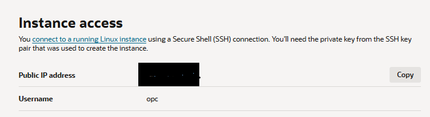

---

## 2. Conceitos rápidos

| Termo | O que é |
|---|---|
| **Chave privada** (`oci_key`) | Fica só com você. É a "senha" para entrar. **Nunca compartilhe nem suba para o GitHub.** |
| **Chave pública** (`oci_key.pub`) | Fica na instância, no arquivo `~/.ssh/authorized_keys`. Pode ser compartilhada. |
| **Por que não dá para recuperar** | A Oracle só guarda a chave pública. A privada nunca passa pela Oracle. |
| **Arquivo `.ppk`** | Formato de chave privada do PuTTY. É gerado a partir da `oci_key` com o PuTTYgen (ver seção 9). |
| **Usuário `opc`** | Usuário padrão das imagens Oracle Linux. Em Ubuntu o usuário é `ubuntu`. |

---

## 3. Pré-requisitos

- Acesso ao console: <https://cloud.oracle.com>
- Um computador com cliente SSH (Windows 10/11 PowerShell, Linux ou Mac).
- IP público da sua internet (pesquise "qual meu ip") para liberar no Bastion.
- Permissões de administrador no tenancy (ou policies para Run Command e Bastion).

---

## 4. Qual método escolher

| Método | Dificuldade | Depende do Cloud Agent? | Resultado neste caso |
|---|---|---|---|
| **A. Run Command** | Fácil | Sim | Travou em *Accepted* (não funcionou) |
| **B. Bastion (Managed SSH)** | Média | Sim (plugin Bastion) | **Funcionou** |
| **C. Nova instância (clone/imagem)** | Média/Alta | Não | Bloqueada por cota e falta de capacidade |
| **D. Console Connection** | Alta | Não | Não testado |

**Ordem recomendada:** A → B → C → D. Tente o mais simples primeiro.

---

## 5. Passo 1: gerar um novo par de chaves

### Windows (PowerShell)

1. Abra o **PowerShell**.
2. Crie a pasta das chaves (se já existir, o erro é inofensivo):
   ```powershell
   mkdir $HOME\.ssh
   ```
   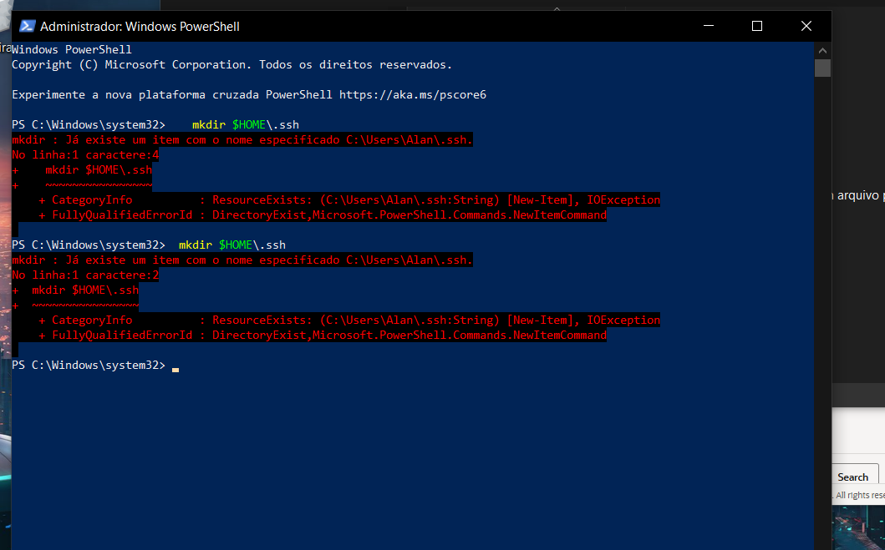

3. Gere a chave com nome próprio, para não sobrescrever chaves antigas:
   ```powershell
   ssh-keygen -t ed25519 -f $HOME\.ssh\oci_key
   ```
4. Quando pedir a **passphrase**, aperte **Enter** duas vezes (sem senha) ou defina uma senha. O cursor não mostra nada ao digitar, é normal.
5. Mostre a chave pública:
   ```powershell
   type $HOME\.ssh\oci_key.pub
   ```
   

6. Copie a chave pública para a área de transferência (evita erro de seleção com o mouse):
   ```powershell
   Get-Content $HOME\.ssh\oci_key.pub | Set-Clipboard
   ```

### Linux ou Mac

```bash
ssh-keygen -t ed25519 -f ~/.ssh/oci_key
cat ~/.ssh/oci_key.pub
```

### Resultado esperado

Dois arquivos na pasta `.ssh`:

- `oci_key` → chave **privada** (guarde com cuidado)
- `oci_key.pub` → chave **pública**, uma linha só no formato:
  ```
  ssh-ed25519 AAAAC3Nza... usuario@computador
  ```

> Se aparecer `oci_key already exists. Overwrite (y/n)?`, responda **n** e escolha outro nome (ex.: `oci_key2`).

### Teste que deve falhar (confirma o problema)

```powershell
ssh -i $HOME\.ssh\oci_key opc@<IP_PUBLICO>
```

Na primeira vez pergunta sobre o fingerprint (responda `yes`) e depois falha com `Permission denied`, porque a instância ainda não conhece a chave nova:

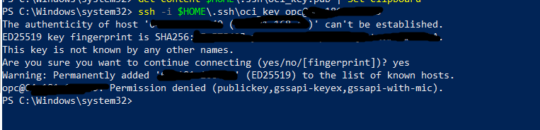

---

## 6. Método A: Run Command (Oracle Cloud Agent)

Executa um script dentro da instância pelo console, sem precisar de SSH.

### 6.1 Verificar o plugin

1. Console → **Compute → Instances →** sua instância.
2. Aba **Management** → seção **Oracle Cloud Agent**.
3. Confirme que **Compute Instance Run Command** está **Enabled** e **Running**. Se não estiver, habilite e aguarde alguns minutos.

> **Atenção:** não confunda com a aba **OS Management**, que é outro serviço (atualizações e patches).

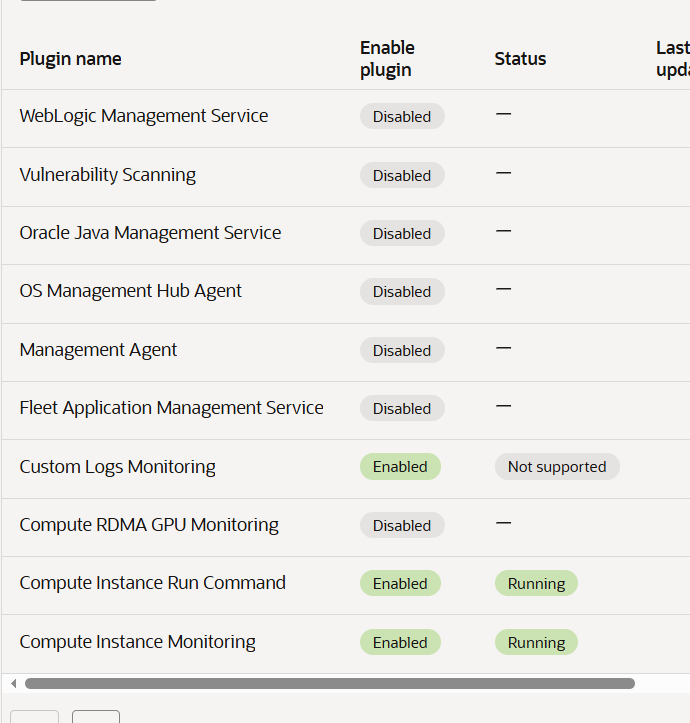

### 6.2 Criar o comando

Na mesma instância: **Resources → Run command → Create command**. Escolha **Text** e cole o script abaixo, trocando a chave pela sua:

```bash
mkdir -p /home/opc/.ssh
echo 'COLE_AQUI_A_CHAVE_PUBLICA' >> /home/opc/.ssh/authorized_keys
chown -R opc:opc /home/opc/.ssh
chmod 700 /home/opc/.ssh
chmod 600 /home/opc/.ssh/authorized_keys
```

**Cuidados:**

- Use **aspas simples** e confira que **abrem e fecham** coladas na chave, sem espaços dentro.
- Mantenha tudo na mesma linha do `echo`.
- As linhas de `chown` e `chmod` são obrigatórias: o SSH recusa a chave se o dono ou as permissões estiverem errados.

Exemplo de comando **incorreto** (falta a aspa de fechamento depois de `alan@Alan`):

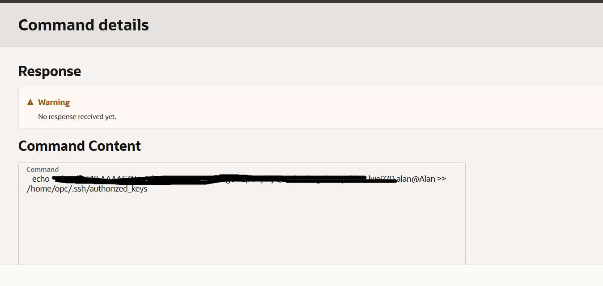

Exemplo de comando **correto**:

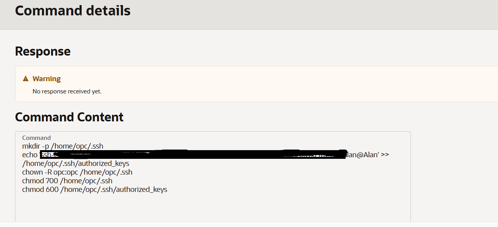

### 6.3 Acompanhar a execução

Atualize a lista de comandos. O esperado é **Execution status = Succeeded** e **Exit code = 0**.

Neste caso, os comandos ficaram parados em **Visible / Accepted** por muito tempo (a causa não foi identificada):

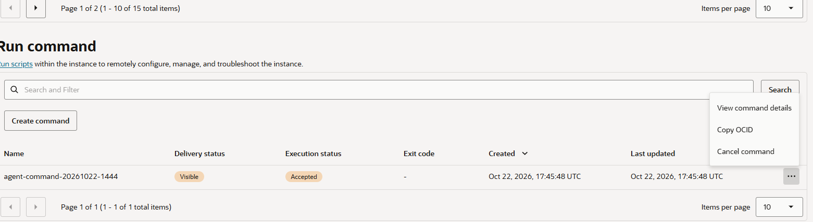

Se isso acontecer por mais de 10 minutos, siga para o **Método B**.

---

## 7. Método B: Bastion (Managed SSH) — o que funcionou

O Bastion cria um túnel até a instância e **injeta temporariamente** a chave pública que você informar na sessão. É gratuito.

### 7.1 Habilitar o plugin Bastion na instância

1. **Compute → Instances →** sua instância → **Management → Oracle Cloud Agent**.
2. Ative o plugin **Bastion** (coluna *Enable plugin*).
3. Aguarde o status ficar **Running** (de 2 a 10 minutos). Atualize a página.

Se tentar criar a sessão antes disso, aparece este erro:

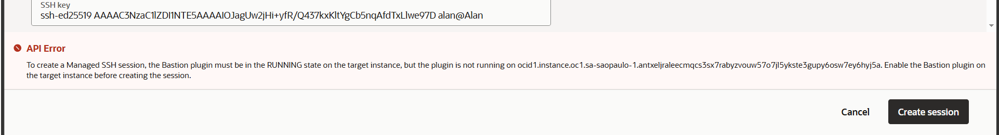

### 7.2 Criar o Bastion

1. Menu (☰) → **Identity & Security → Bastion → Create bastion**.
2. Configure:
   - **Type:** Internet
   - **VCN** e **Subnet:** os mesmos da instância (a subnet precisa conseguir alcançar a instância)
   - **CIDR block allowlist:** seu IP público com `/32`, por exemplo `203.0.113.10/32`
3. Aguarde o estado **Active**.

> Se você usa VPN, desative antes de conferir o IP. Se o IP residencial mudar depois, edite o Bastion e atualize o CIDR.

### 7.3 Criar a sessão Managed SSH

1. Dentro do Bastion → **Create session**.
2. Preencha:
   - **Session type:** Managed SSH session
   - **Username:** `opc`
   - **Compute instance:** sua instância
   - **Add SSH key:** *Paste public key* → cole o conteúdo de `oci_key.pub`
3. Clique em **Create session** e aguarde **Active**. A sessão dura 3 horas (TTL padrão).

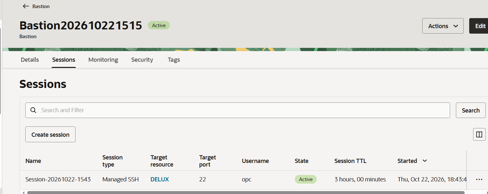

### 7.4 Montar o comando SSH

1. Na sessão, clique nos três pontinhos (**...**) → **Copy SSH command**.
2. Cole num bloco de notas. Ele vem assim:
   ```
   ssh -i <privateKey> -o ProxyCommand="ssh -i <privateKey> -W %h:%p -p 22 ocid1.bastionsession.oc1.sa-saopaulo-1.xxxxxxxx@host.bastion.sa-saopaulo-1.oci.oraclecloud.com" -p 22 opc@<IP_PRIVADO>
   ```
3. Troque **as duas** ocorrências de `<privateKey>` (incluindo os sinais `<` e `>`) pelo caminho da sua chave privada:
   ```powershell
   ssh -i C:/Users/<SEU_USUARIO>/.ssh/oci_key -o ProxyCommand="ssh -i C:/Users/<SEU_USUARIO>/.ssh/oci_key -W %h:%p -p 22 ocid1.bastionsession.oc1.sa-saopaulo-1.xxxxxxxx@host.bastion.sa-saopaulo-1.oci.oraclecloud.com" -p 22 opc@<IP_PRIVADO>
   ```
4. Cole no PowerShell. Responda `yes` às perguntas de fingerprint (podem aparecer duas vezes: Bastion e instância).

**Regras importantes:**

- Tudo em **uma linha só**.
- No Windows, use **barras normais (`/`)** no caminho da chave dentro do comando.
- Não mantenha textos de exemplo como `SESSION_OCID` ou `<privateKey>`: o OCID real da sessão vem no comando copiado do console.
- Confirme que o arquivo existe: `dir C:\Users\<SEU_USUARIO>\.ssh\oci_key`.

Erro típico quando `<privateKey>` não é trocado ou o caminho está errado:

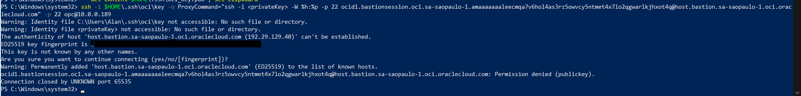

### 7.5 Sucesso

Aparece o prompt da instância (ainda **não termine por aqui**: siga para a seção 8 para gravar a chave de forma permanente):

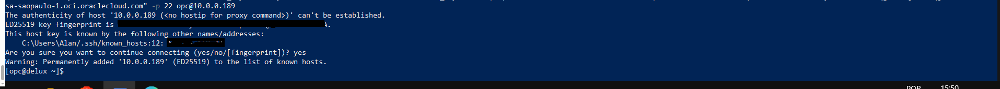

---

## 8. Passo final: tornar a chave permanente e testar

> **Status: validado neste caso.** Depois de encerrar a sessão do Bastion, o SSH direto com a chave permanente funcionou.

A chave que o Bastion injeta é **temporária**: ela some quando a sessão termina. Por isso, dentro da instância (ainda na sessão do Bastion), é preciso gravar a sua chave de forma definitiva.

### 8.1 Gravar a chave permanente

```bash
mkdir -p ~/.ssh
printf '\n%s\n' '<CHAVE_PUBLICA_COMPLETA> <COMENTARIO>-permanente' >> ~/.ssh/authorized_keys
chmod 700 ~/.ssh
chmod 600 ~/.ssh/authorized_keys
cat -A ~/.ssh/authorized_keys
```

- `<CHAVE_PUBLICA_COMPLETA>` é o tipo e o corpo da chave do `oci_key.pub` (`ssh-ed25519 AAAA...`), **sem** o comentário final.
- `<COMENTARIO>-permanente` é um comentário diferente do original (ex.: `usuario@computador-permanente`). Assim a linha permanente é distinguível da temporária.
- O `printf '\n%s\n'` garante uma **quebra de linha antes** da chave. Se o arquivo não terminar com quebra de linha, um `echo` simples cola a chave nova no fim da linha anterior e quebra as duas.
- O `cat -A` mostra um `$` no fim de cada linha, para você conferir que cada chave está em linha própria.

> **Não use `grep` para "evitar duplicar".** Durante a sessão do Bastion, a chave temporária já está no arquivo. Um comando como `grep -q 'comentario' ... || echo ...` encontra essa linha temporária, **pula o `echo`**, e a chave nunca é gravada de forma permanente. É normal a mesma chave aparecer mais de uma vez.

### 8.2 O que esperar na saída do `cat -A`

```
$
#ocid1.bastionsession.oc1.sa-saopaulo-1.xxxxxxxx$
ssh-ed25519 AAAA...  usuario@computador^M$
ssh-ed25519 AAAA...  usuario@computador$
$
ssh-ed25519 AAAA...  usuario@computador-permanente$
```

| Linha | Significado |
|---|---|
| `#ocid1.bastionsession...` seguida de uma chave | Chave **temporária** do Bastion. Desaparece com a sessão. |
| `^M$` no final de uma linha | Caractere de quebra de linha do Windows, vindo da área de transferência. É inofensivo, mas indica que a linha veio de um copiar e colar do Windows. |
| Linha terminando em `-permanente$` | A sua chave **permanente**, em linha própria e sem `^M`. É a que importa. |

Sinal de problema: uma linha longa com duas chaves coladas (`...usuario@computadorssh-ed25519 AAAA...`). Corrija reescrevendo com o `printf` acima.

### 8.3 Validar de verdade

Testar o SSH direto **enquanto a sessão do Bastion está ativa não prova nada**, porque a chave temporária também funciona. Valide assim:

1. No console, em **Bastion → Sessions**, abra os três pontinhos da sessão e escolha **Terminate** (ou **Delete**).
2. Aguarde cerca de um minuto para o agente da instância remover a chave temporária.
3. Em outro PowerShell, teste:
   ```powershell
   ssh -i $HOME\.ssh\oci_key opc@<IP_PUBLICO>
   ```
4. Se entrar, a chave permanente está funcionando.

### 8.4 Se o teste falhar (Permission denied)

1. Entre por uma **nova sessão do Bastion** e rode `cat -A ~/.ssh/authorized_keys`. Confirme que a linha `-permanente` continua lá.
2. Corrija o contexto do SELinux (Oracle Linux): `restorecon -R ~/.ssh`
3. Confirme dono e permissões: `chown -R opc:opc ~/.ssh`, `chmod 700 ~/.ssh`, `chmod 600 ~/.ssh/authorized_keys`.
4. Se o Bastion estiver apagando também a linha permanente (ele pode remover por conteúdo da chave), gere um **segundo par** (`oci_key2`, conforme a seção 5) e grave só a pública dele na instância. Use `oci_key` para o Bastion e `oci_key2` para o acesso direto.

### 8.5 Limpeza opcional

- Bastion e sessões podem ser removidos ou mantidos como plano B (serviço gratuito).
- Comandos do Run Command que ficaram travados não exigem ação.
- Clones de boot volume e imagens personalizadas que não serão mais usados devem ser apagados para liberar cota.

---

## 9. Acessar pelo PuTTY (Windows)

> **Observação:** esta seção segue o procedimento padrão do PuTTY. Não foi testada passo a passo neste caso, mas a chave pública na instância é a mesma, então não há nada a mudar do lado da Oracle.

O PuTTY **não lê** a chave no formato gerado pelo `ssh-keygen`. Ele usa o formato **`.ppk`**, então é preciso converter a `oci_key` com o **PuTTYgen**.

**Pré-requisito:** a chave pública já deve estar gravada de forma permanente na instância (seção 8) e o SSH direto pelo PowerShell deve funcionar.

### 9.1 Instalar o PuTTY

Baixe pelo site oficial e instale o pacote completo, que inclui **PuTTY** e **PuTTYgen**. Use a versão mais recente: versões antigas não leem chaves ed25519.

### 9.2 Converter a chave para `.ppk`

1. Abra o **PuTTYgen** (menu Iniciar).
2. Vá em **Conversions → Import key**.
3. Selecione `C:\Users\<SEU_USUARIO>\.ssh\oci_key` (o arquivo **sem** extensão, que é a privada). Se a pasta `.ssh` não aparecer, digite o caminho no campo do nome do arquivo e mude o filtro para *All Files (\*.\*)*.
4. Se a chave tiver passphrase, informe-a. Se foi criada sem senha, nada aparece.
5. Clique em **Save private key**. Se perguntar sobre salvar sem passphrase, confirme em **Yes** (ou defina uma senha antes).
6. Salve como `oci_key.ppk`, por exemplo em `C:\Users\<SEU_USUARIO>\.ssh\`.

### 9.3 Configurar a sessão

1. Abra o **PuTTY**.
2. Em **Session**:
   - **Host Name:** `opc@<IP_PUBLICO>`
   - **Port:** `22`
   - **Connection type:** SSH
3. No menu da esquerda, vá em **Connection → SSH → Auth → Credentials** (em versões antigas, **Connection → SSH → Auth**) e, em **Private key file for authentication**, clique em **Browse** e escolha o `oci_key.ppk`.
4. Opcional: em **Connection → Data**, preencha **Auto-login username** com `opc`.
5. Volte para **Session**, escreva um nome em **Saved Sessions** (ex.: `DELUX`) e clique em **Save**.
6. Clique em **Open**. Na primeira conexão, o alerta sobre a chave do servidor deve ser aceito em **Accept**.

Quando aparecer `[opc@<nome-da-maquina> ~]$`, o acesso está funcionando.

### 9.4 Erros comuns no PuTTY

| Mensagem | Causa e solução |
|---|---|
| `Couldn't load private key` / `unable to import` | PuTTY ou PuTTYgen desatualizado. Instale a versão mais recente. |
| `No supported authentication methods available` | O `.ppk` não foi selecionado na sessão ou o usuário está errado. Confira o passo 9.3. |
| `Server refused our key` | A chave pública não está gravada de forma permanente, ou as permissões do `~/.ssh` estão erradas. Refaça a seção 8. |
| `Network error: Connection timed out` | IP errado, instância parada ou porta 22 bloqueada na Security List/NSG. |

### 9.5 Bastion no PuTTY

O Bastion exige um **proxy configurado à parte** (um `ProxyCommand` equivalente ao do PowerShell) e é bem mais trabalhoso no PuTTY. Para esse plano B, o mais prático é manter o comando do PowerShell da seção 7.4. O acesso direto ao `<IP_PUBLICO>`, que é o uso normal, funciona sem esse proxy.

---

## 10. Método C: nova instância a partir de clone ou imagem

Use quando os métodos A e B não funcionarem (agente travado). Não depende do Cloud Agent, mas gera uma instância **nova** com **IP diferente**.

> Não apague a instância original até entrar na nova e confirmar que os dados estão lá.

### 9.1 Opção 1: imagem personalizada

1. Instância → **Actions → Create custom image**. A instância fica offline por alguns minutos.
2. Espere a imagem ficar **Available** em **Compute → Custom Images**.
3. Na imagem → **Create instance** e informe a chave pública na criação.

Se der erro de cota (`custom-image-count`), apague uma imagem antiga em **Compute → Custom Images** ou use a opção 2:

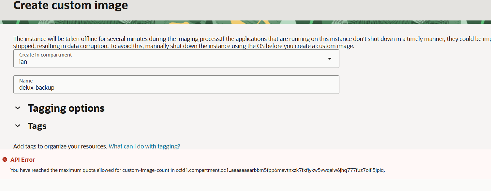

### 9.2 Opção 2: clone do boot volume (não consome cota de imagens)

1. **Storage → Block Storage → Boot Volumes →** boot volume da instância → **Clone boot volume** (idealmente com a instância parada).
2. Em **Compute → Instances → Create instance → Change image → aba Boot volumes**, escolha o clone.

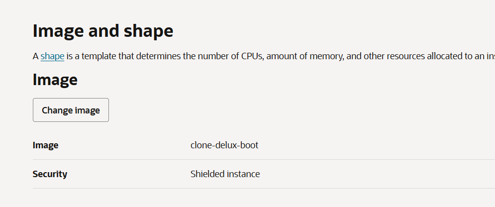

3. Em **Add SSH keys**, escolha **Paste public key** (ou *Upload public key file*) e informe a **sua** chave. Não use *Generate a key pair for me*, que criaria outro par.

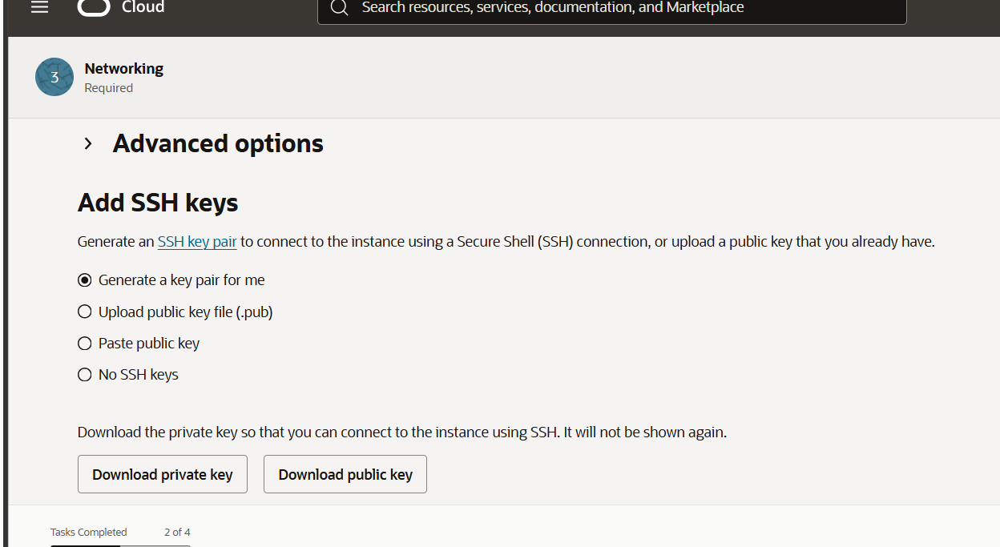

4. Em **Networking**, use a mesma VCN, a **subnet pública** e marque **Automatically assign public IPv4 address**.
5. Conecte com o novo IP:
   ```powershell
   ssh -i $HOME\.ssh\oci_key opc@<NOVO_IP>
   ```

**Limitações conhecidas:**

- O OCI injeta a chave no formulário apenas no primeiro boot de uma imagem. Em instâncias criadas de clone, a chave pode não ser aplicada. Se der `Permission denied`, repita o Método A ou B na instância nova.
- **`Out of capacity for shape VM.Standard.E2.1.Micro`:** falta de capacidade do shape gratuito na região. Tente em outros horários (madrugada e manhã cedo costumam ser melhores) e deixe o *fault domain* como "Let Oracle choose".
- O boot volume é x86: não inicia em shapes ARM (A1.Flex).

---

## 11. Método D: Console Connection (não testado)

> Esta seção **não foi testada** neste caso. Use como referência e valide antes de depender dela.

Acesso pela console serial da instância, sem rede nem agente.

1. Instância → **Resources → Console connection → Launch Cloud Shell connection** (informe a chave pública se pedir).
2. Reinicie a instância (**Actions → Reboot**) e aperte **Esc** repetidamente no boot até aparecer o menu do GRUB.
3. Na entrada do kernel, aperte **e** e adicione `rd.break` ao final da linha que começa com `linux`. Aperte **Ctrl+X**.
4. No prompt `switch_root:/#`:
   ```bash
   mount -o remount,rw /sysroot
   chroot /sysroot
   echo '<CHAVE_PUBLICA_COMPLETA>' >> /home/opc/.ssh/authorized_keys
   chown -R opc:opc /home/opc/.ssh
   chmod 700 /home/opc/.ssh
   chmod 600 /home/opc/.ssh/authorized_keys
   touch /.autorelabel
   exit
   exit
   ```
5. O próximo boot é mais demorado (relabel do SELinux). Depois teste o SSH.

**Riscos:** instâncias *Shielded* podem bloquear a edição do GRUB; o tempo do GRUB é curto; colar texto na console serial pode truncar a chave (confira com `cat`).

---

## 12. Tabela de erros e soluções

| Sintoma / mensagem | Causa provável | Solução |
|---|---|---|
| `mkdir : Já existe um item com o nome especificado ...\.ssh` | A pasta `.ssh` já existe | Ignore, é inofensivo. Siga para o `ssh-keygen`. |
| `oci_key already exists. Overwrite (y/n)?` | Já existe uma chave com esse nome | Responda `n` e use outro nome. |
| `Permission denied (publickey,gssapi-keyex,gssapi-with-mic)` ao conectar direto | A instância ainda não tem a sua chave pública | Instale a chave por um dos métodos A, B, C ou D. |
| `Are you sure you want to continue connecting?` | Primeira conexão ao host | Responda `yes`. |
| `REMOTE HOST IDENTIFICATION HAS CHANGED` | Mesmo IP, instância diferente (ex.: nova instância) | Rode `ssh-keygen -R <IP>` e conecte de novo. |
| `UNPROTECTED PRIVATE KEY FILE` / `bad permissions` (Windows) | Arquivo da chave legível por outros usuários | `icacls $HOME\.ssh\oci_key /inheritance:r` e depois `icacls $HOME\.ssh\oci_key /grant:r "$($env:USERNAME):(R)"` |
| Run Command parado em **Visible / Accepted** | Agente não processa o comando (causa não identificada) | Aguarde 10 min; tente Stop/Start da instância; se persistir, use o Bastion. |
| Run Command com `echo "ssh-ed25519 ... alan@Alan >> ...` | Aspa de fechamento faltando | Recrie com aspas simples abrindo e fechando a chave. |
| Depois que a sessão do Bastion acaba, o SSH direto volta a negar | A chave gravada era só a temporária do Bastion (o `grep` pulou o `echo`) | Entre por nova sessão do Bastion e grave a chave com `printf ... >> ~/.ssh/authorized_keys` (sem `grep`), conforme o passo final. |
| Chave instalada mas SSH continua negando | Dono/permissões errados em `.ssh` ou contexto do SELinux | `chown -R opc:opc ~/.ssh`, `chmod 700 ~/.ssh`, `chmod 600 ~/.ssh/authorized_keys` e `restorecon -R ~/.ssh`. |
| `^M` no `cat -A` do `authorized_keys` | Quebra de linha do Windows vinda do copiar e colar | Inofensivo na maioria dos casos. Para limpar: `sed -i 's/\r$//' ~/.ssh/authorized_keys`. |
| Duas chaves coladas na mesma linha do `authorized_keys` | O arquivo não terminava com quebra de linha e foi usado `echo` | Regrave com `printf '\n%s\n' '<CHAVE>' >> ~/.ssh/authorized_keys`. |
| Erros do PuTTY (`Couldn't load private key`, `Server refused our key`, etc.) | Versão antiga, `.ppk` não selecionado ou chave não permanente | Veja a tabela da seção 9.4. |
| `To create a Managed SSH session, the Bastion plugin must be in the RUNNING state` | Plugin Bastion desabilitado ou ainda subindo | Habilite o plugin em Management → Oracle Cloud Agent e espere **Running**. |
| Bastion: `Permission denied (publickey)` logo no primeiro salto | `<privateKey>` não substituído, caminho errado ou chave diferente da colada na sessão | Troque as **duas** ocorrências de `<privateKey>`, use `/` no caminho, confirme que o arquivo existe e que a chave pública da sessão é a do `oci_key.pub`. |
| Bastion: usuário `SESSION_OCID` ou texto de exemplo no comando | Espaço reservado copiado literalmente | Use o OCID real do comando copiado em **Copy SSH command**. |
| Bastion: timeout ou conexão recusada | IP de internet mudou ou porta 22 bloqueada | Atualize o CIDR do Bastion; confira Security List/NSG (TCP 22 vindo da subnet do Bastion). |
| Bastion: sessão some ou deixa de funcionar | TTL expirou (3 horas) | Crie outra sessão com a mesma chave. |
| `You have reached the maximum quota allowed for custom-image-count` | Limite de imagens personalizadas atingido | Apague imagem antiga ou use clone de boot volume. |
| `Out of capacity for shape VM.Standard.E2.1.Micro in availability domain AD-1` | Falta de capacidade do shape gratuito na região | Tente em outros horários; não use outro shape (ARM não inicia boot x86). |
| Instância criada de clone não aceita a chave do formulário | Chave só é injetada no primeiro boot de uma imagem | Use o Método A ou B na instância nova. |
| Aba **OS Management** mostra aviso de agente | Serviço diferente do necessário | Ignore. Use **Management → Oracle Cloud Agent**. |

---

## 13. Boas práticas para não perder a chave de novo

- Guarde uma **cópia da chave privada** (`oci_key`) em local seguro: gerenciador de senhas, pendrive ou cofre criptografado.
- Use um **nome descritivo** para cada chave (ex.: `oci_delux`) e anote em qual instância ela está.
- **Nunca** suba a chave privada para o GitHub. Adicione ao `.gitignore` do repositório:
  ```
  *.pem
  oci_key
  id_*
  ```
- Mantenha mais de uma chave pública autorizada (uma principal e uma de backup) no `authorized_keys`.
- Habilite o plugin **Bastion** e crie o Bastion com antecedência, assim há um plano B pronto.
- Reserve um **Reserved Public IP** se não quiser que o IP mude ao recriar a instância.
- Antes de operações arriscadas, faça backup do **boot volume**.

---

## 14. Resumo dos comandos

```powershell
# 1. Gerar chave (Windows)
ssh-keygen -t ed25519 -f $HOME\.ssh\oci_key
Get-Content $HOME\.ssh\oci_key.pub | Set-Clipboard

# 2. Conectar direto (depois de instalar a chave)
ssh -i $HOME\.ssh\oci_key opc@<IP_PUBLICO>

# 3. Conectar via Bastion (trocar as duas <privateKey> e o OCID da sessão)
ssh -i C:/Users/<SEU_USUARIO>/.ssh/oci_key -o ProxyCommand="ssh -i C:/Users/<SEU_USUARIO>/.ssh/oci_key -W %h:%p -p 22 <OCID_DA_SESSAO>@host.bastion.sa-saopaulo-1.oci.oraclecloud.com" -p 22 opc@<IP_PRIVADO>
```

```bash
# 4. Dentro da instância: gravar a chave de forma permanente
mkdir -p ~/.ssh
printf '\n%s\n' '<CHAVE_PUBLICA_COMPLETA> <COMENTARIO>-permanente' >> ~/.ssh/authorized_keys
chmod 700 ~/.ssh
chmod 600 ~/.ssh/authorized_keys
cat -A ~/.ssh/authorized_keys
```

```text
# 5. Validar: encerrar a sessão do Bastion no console e testar o SSH direto (passo 2).
# 6. PuTTY: converter oci_key em oci_key.ppk com o PuTTYgen (Conversions -> Import key
#    -> Save private key) e apontar o .ppk em Connection -> SSH -> Auth -> Credentials.
```

---

## Aviso sobre os prints antes de publicar

Os prints foram capturados em um ambiente real. Antes de tornar o repositório público, **revise e esconda (borre) dados sensíveis**, como:

- IPs públicos e privados (`01-instance-access.png`, `04-permission-denied.png`, `12-acesso-ok.png`)
- OCIDs de instância e de sessão do Bastion (`09-bastion-plugin-nao-running.png`, `15-bastion-permission-denied.png`)
- Nome de usuário do Windows e do tenancy, quando aparecerem

Chaves **públicas** e fingerprints não são segredos, mas não há necessidade de expô-los.
